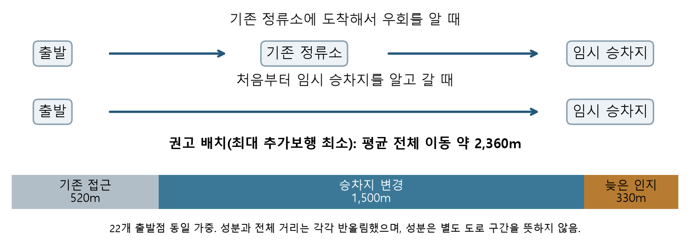
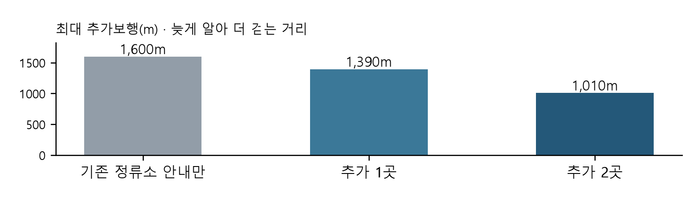

# 버스 임시우회 안내의 도달 범위와 이동 격차

## 분석 배경 및 목적

### 문제: 바뀐 승차 위치와 그곳까지 가는 방법을 함께 알려야 한다

2026년 10월 13일 MBC는 서울역 버스환승센터에서 8800번을 90분 넘게 기다렸다는 이용자와 경기 광역버스의 현장 우회 안내 공백을 보도했다. [1] 마라톤으로 버스가 우회할 때 이용자가 이를 제때 알지 못하면, 평소 정류소에서 기다리거나 바뀐 승차지를 찾아 이동해야 하는 문제가 드러난다.

이를 계기로 공식 공지와 임시 승차 위치를 확보한 별도의 2026년 4월 8800번 우회 계획을 분석했다. 평소 정류소까지 갔다가 CPBC 건물 앞에서 타야 한다는 안내를 받으면, 처음부터 그 위치를 알고 갔을 때보다 더 걸을 수 있다. 서울역 주변 지하철 출입구 22곳을 출발점으로 삼아, 이런 헛걸음을 줄일 안내판 2곳의 위치와 임시 승차지까지의 이동 부담을 비교했다.

권고 배치의 평균 전체 이동거리는 약 2,360m로, 평소 정류소까지의 거리 520m, 승차지가 바뀌어 늘어난 거리 1,500m, 늦게 알아 더 걷는 거리 330m로 구성된다. 평소보다 늘어난 거리 중 늦은 인지의 몫은 약 18%이고 대부분은 승차지 변경 자체에서 생기므로, 안내를 앞당기는 조치와 실제 탈 수 있는 승차 대안을 함께 마련해야 한다.

### 핵심 결과와 권고: 현행 대비 최대 추가보행 약 37% 감소

권고안은 기존 정류소 안내만 있는 현행 비교모형의 최대 추가보행을 약 1,600m에서 1,010m로 37% 줄인다. 합계 최소안 대비로는 약 27% 감소하며, 22개 경로의 합계는 약 50m(0.6%) 늘어난다. 현행보다 11개 경로가 짧아지고 11개는 같아, 더 길어지는 경로는 없다.

승차지 변경만으로 22개 출발점 모두 500m 이상, 20개는 1,000m 넘게 더 걸었다. 계단을 제외한 지도에서는 3곳의 연결을 확인하지 못했으나, 공식 자료는 GTX-A 1번출구 엘리베이터와 공항철도 서울역 시설을 안내한다. 이에 공지에 계단을 피하는 보행 동선과 다른 정류소에서 타는 방법을 함께 제시하도록 제안한다. [2]

사례는 2026년 4월 5일 더 레이스 서울 21K에 따른 8800번 우회 계획으로, 수원시 공지는 05:00~11:30 예정이며 통제가 풀리면 즉시 복귀한다고 안내했다. 서울역 환승센터 6번승강장(02006)을 지나지 않고 CPBC 건물 앞에서 임시 승하차하는 계획이었다. [3]

## 활용 데이터와 분석 방법

### 활용 데이터

| 데이터명 | 제공기관 | 플랫폼 | URL |
| --- | --- | --- | --- |
| 2026-04-05 버스 우회 공지·노선도 | 수원시 | 시정소식 | https://www.suwon.go.kr/web/board/BD_board.view.do?bbsCd=1042&seq=20260402100206435 |
| 버스정류소 위치정보 20260402·20260902 | 서울특별시 | 서울 열린데이터광장 | https://data.seoul.go.kr/dataList/OA-15067/A/1/datasetView.do |
| 행사일 도로·출입구·승강장·건물 기록 | OSM 기여자 | VK 공개 Overpass | https://maps.mail.ru/osm/tools/overpass/api/interpreter |
| CPBC 건물 주소·위치 안내 | CPBC | 공식 회사소개 | https://web.cpbc.co.kr/company/page/page1-8.html |
| 버스 우회 공지 5건(2026-10-12~16) | 서울특별시 | TOPIS | https://topis.seoul.go.kr/notice/openNoticeList.do |
| 서울역 엘리베이터·편의시설 안내 | GTX-A·공항철도 | 운영사 공식 웹 | https://www.gtx-a.com/noticeDetail.do?boardId=177 ; https://www.airportrailroad.com/train/normal/info/010/0 |

수원시 공지로 우회 시간·미경유 정류소·대체 승차지를, 서울시 자료로 정류소 ID·위치를 확인했으며, 도로 연결은 OSM, 건물 식별은 CPBC 안내를 활용했다. 별도 TOPIS 공지와 운영사 시설 자료는 AI 추출 대조와 접근시설 교차 확인에 썼다. [2~8]

### 22개 출발점과 승강장 연결

행사일 한국시간 07:00(2026-04-04 22:00 UTC)의 OSM 기록에서 기존 정류소 반경 500m 내 지하철 출입구 22곳을 정했다. 9-1출구를 포함해 버스 승객용 선형 승강장 6곳의 기존 보행 연결을 반영하되 차량 전용로·통행 금지·면 승강장은 제외했다. [5,6]

출입구·승차지는 적격 선형에 투영해 EPSG:32652에서 거리를 재고 NetworkX로 최단경로를 구했으며, 없는 직선 연결은 추가하지 않았다. 출발점은 같은 비중으로 비교해 실제 승객 수나 집단별 수요를 대표하지 않는다. 지도상 거리는 10m 단위로 반올림했고 차이·비율은 원값으로 계산했다.

### 무엇을 비교했는가

‘늦게 알아 더 걷는 거리’(이하 추가보행)는 출발점에서 안내를 거쳐 임시 승차지까지 간 전체 거리에서, 처음부터 그 위치를 알고 곧바로 간 거리를 뺀 값이다. ‘승차지 변경 추가거리’는 임시 승차지를 미리 알고 갈 때와 평소 승차지까지의 거리 차이로, 안내 시점에서 생긴 부담과 승차 위치가 바뀌어 생긴 부담을 구분한다.

기존 정류소 안내를 유지하면서 그곳까지 경로상 450m 이내인 교차점·출발점 50곳에서 추가 안내 2곳의 조합 1,225개를 비교했다. 각 경로에서 처음 만난 안내를 읽고 임시 승차지로 향한다고 가정했으며, 450m는 후보 탐색 범위다.

접근성은 출입구 시작점을 고정하고 계단·지도상 휠체어 통행 불가 연결을 제외해 점검했으며, 실제 보도·횡단·엘리베이터 가동·차량 승차는 현장 확인 대상으로 구분했다.

## 분석 결과: 안내를 늘리는 것과 잘 배치하는 것

### 비교 1. 같은 안내판 2곳이라도 배치 기준에 따라 결과가 달라진다

| 배치 기준 | 추가 안내 도달 경로 | 추가보행 최대 | 22경로 추가보행 합계 | 전체 이동 최대 |
| --- | --- | --- | --- | --- |
| 안내 도달 경로 수 최대 | 22 | 1,390m | 10,280m | 3,400m |
| 추가보행 합계 최소 | 21 | 1,370m | 7,280m | 3,380m |
| 가장 긴 추가보행 최소(권고) | 11 | 1,010m | 7,330m | 3,590m |

추가 안내판 두 곳은 22개 경로 중 가장 많이 더 걷는 경로의 부담을 줄이는 위치에 두도록 제안한다. 합계 최소안보다 추가보행 합계는 약 50m(0.6%) 늘지만 최대 추가보행은 27% 줄어든다. 가장 큰 추가부담을 먼저 낮추고, 같은 최댓값에서는 합계가 작은 안을 고르며, 변화율은 원값으로 계산했다.

‘현행’은 기존 정류소에서만 안내하는 비교모형이며, ‘추가 안내 도달’은 그 전에 추가 안내판을 만나는 경로 수다. 권고안은 도달 11개가 모두 개선되고, 나머지 11개도 기존 안내가 유지돼 현행과 같다. 아래 표는 권고안의 이동거리를 각 기준과 비교한 결과다.

| 권고안의 비교 기준 | 짧아짐 | 동일 | 길어짐 |
| --- | --- | --- | --- |
| 현행: 기존 정류소 안내만 | 11 | 11 | 0 |
| 도달 경로 수 최대안 | 11 | 0 | 11 |
| 추가보행 합계 최소안 | 4 | 8 | 10 |

합계 최소안보다 전체 이동거리의 최댓값은 약 3,380m에서 3,590m로 늘어난다. 도달수 최대안보다 길어진 11개 경로에는 출입구의 글·그림 안내와 승차 대안을 보강하되, 추가 수량·설치비와 전체 경로를 다시 계산해 권고안의 최대 추가보행을 높이지 않는 안만 채택한다.

### 비교 2. 최댓값 최소 기준으로 안내 수량별 위치를 다시 골랐다

기존 정류소 안내만 있을 때 최대 추가보행은 약 1,600m이고, 추가 안내 1곳은 1,390m, 2곳은 1,010m다. 수량마다 위치를 새로 골랐으므로 현행보다 짧아지는 경로는 21개에서 11개로 줄지만, 2곳 배치에서도 나머지 11개는 현행과 같다.

## 이동 격차: 계단 없는 경로와 승차까지 확인한다

### 계단을 제외한 지도에서 연결이 확인되지 않은 3곳을 교차 점검했다

계단을 제외하자 22개 출입구 중 3곳에서 임시 승차지까지의 경로를 지도상 확인할 수 없었다. 그러나 GTX-A 공식 공지는 서울역 1번출구 엘리베이터를 명시하고, 공항철도 공식 서울역 자료도 엘리베이터 시설을 안내하므로, 이 결과는 실제 시설 부재나 접근 불가가 아닌 지도 연결정보의 한계로 해석해야 한다. [2,5]

| 우선 확인 대상 | 지도와 공식 자료의 대조 | 남은 확인 사항 |
| --- | --- | --- |
| 서울역 1번출구(GTX-A) | 계단 제외 시 지도상 연결 확인 불가. 공식 공지에 1번출구 엘리베이터 명시 | 엘리베이터 위치와 지도 시작점 대조, 지상부터 임시 승차지까지 연결 |
| 서울역 2번출구(공항철도) | 계단 제외 시 지도상 연결 확인 불가. 공식 역 안내에 엘리베이터 시설 확인 | 해당 2번출구와의 연결 및 계단 없는 지상 동선 |
| 지도상 ‘출입구 1’ | 계단 제외 시 지도상 연결 확인 불가. 출입구 명칭과 공식 시설의 일대일 대응 미확정 | 출입구 식별 후 대체 출입구·엘리베이터 연결 |
| 회현역 4번출구 | 이번 OSM 원본에 휠체어 접근 불가로 표시 | 같은 역의 접근 가능한 출입구와 실제 승차 대안 |

이번 OSM 원본에는 22곳 중 20곳의 ‘휠체어 접근 여부’ 항목이 없었으며, 다른 기관의 시설정보까지 없다는 뜻은 아니다. 나머지 18곳은 제약을 제외해도 지도상 경로가 남았지만, 보도·턱·경사·횡단과 차량 승차 가능성은 별도 확인이 필요하다.

### AI 활용: 공지 5건을 실제 추출하고 별도 결과와 대조했다

Codex로 공지의 시간·노선·승차 위치를 정리하고 분석 코드·도표 작성을 보조했으며, 경로와 안내 배치는 최단경로·후보 조합 계산으로 구했다. 추가로 기존 분석에 쓰지 않은 TOPIS 버스 우회 공지 5건에서 해당 날짜, 우회·통제 시작과 종료시각, 본문에 열거된 노선번호, 노선 수의 5개 항목을 추출했다. [8]

별도 에이전트가 예측값을 보지 않고 원문에서 만든 대조값과 코드로 비교한 결과 25개 항목이 모두 일치했다. 이는 소규모 원문 기반 추출 대조로, 사람 정답표에 대한 정확도나 검수시간 절감률은 별도 실험으로 평가해야 한다.

## 정책 제안: 우회안에 이동 지원계획을 함께 붙인다

### 실행 규칙: 가장 긴 추가보행을 낮추고 길어진 경로를 보완한다

수원과 서울역을 오가는 8800번의 운행 변경은 수원시 담당부서와 8800번을 운행하는 버스회사가 준비하고, 서울 구간의 통제 범위·대기 장소·정차 여건은 서울시 교통 담당부서·관할 경찰·정류소 관리기관과 협의하도록 제안한다.

| 결정 단계 | 이번 사례에 적용할 내용 |
| --- | --- |
| ① 안내 기본안 선택 | 가장 긴 추가보행이 최소가 되는 안내 2곳을 기본안으로 삼고, 같은 최댓값에서는 합계가 작은 배치를 선택한다. 도달수 우선안보다 길어진 11개 경로의 사전 안내를 보강할 때는 추가 수량·비용과 전체 경로를 다시 계산해 최대 추가보행이 커지지 않는 안을 채택한다. |
| ② 실제 승차 동선 확보 | 지도상 연결 확인 불가 3곳과 회현역 4번출구를 먼저 점검한다. 대체 출입구·엘리베이터부터 임시 승차지까지의 연결, 가동시간과 휠체어 승차 차량을 확인한다. |
| ③ 승차 대안과 공지 확정 | 연결을 확보하지 못하거나 추가거리가 큰 경로는 다른 기존 정류소·대중교통 환승·연결수단을 비교해 운행시간·요금·지원 연락처를 안내한다. 평소 정류소에도 글·그림 안내를 남긴다. |

승차지 변경만으로 1,000m 이상 더 걷는 경로 20개와 지도상 연결 확인 불가 3곳은 먼저 점검할 목록이며, 중복될 수 있어 더해 피해 규모로 계산하지 않는다. 공지에는 승차 위치 지도와 걸어서 가는 길을 함께 싣고, QR은 상세 정보를 제공하는 보조 수단으로 활용한다.

### 적용 범위와 성과는 행사·공사별로 집계한다

BTS 행사 86개 노선, 서소문고가 31개 노선처럼 여러 노선이 함께 바뀌는 경우에도 같은 절차를 적용할 수 있다. [9,10] 사건·노선·방향·기간이 같은 중복 공지를 합친 뒤 영향 정류소의 시간대별 승차량을 연결하면 대상 이동 규모를 집계할 수 있으며, 다른 사건의 거리 개선치는 해당 장소에서 다시 계산한다.

시범 적용에서는 버스를 타려던 이동을 기준으로 추가보행·탑승 성공·이동 포기·교통수단 전환을 조사하고, 계단 없는 동선과 승차 지원은 이용 당사자와 함께 확인한다. AI는 별도 공지의 사람 정답표와 비교해 항목별 일치율을 구하고, 사람이 처음부터 정리한 시간과 AI 결과를 수정해 완성한 시간을 같은 완료 기준으로 측정한다.

### 탄소중립: 자동차 전환을 줄인 경우의 효과를 조건부로 산정한다

예시로 대상 이동 100회 중 1회의 자가용 전환을 막고, 차량 1대·1인 탑승·5km·연비 15km/L를 가정하면 대상 이동 1회당 약 7g CO₂다. 계산은 1% × 5km × 140g/km이며, 140g/km는 국내 지침의 휘발유 발열량·CO₂ 계수와 가정 연비를 결합했다. [11]

실제 평가는 버스 탑승 유지·자가용과 택시 전환·다른 대중교통 이용·이동 취소를 구분하고, 자동차 전환 감소가 확인된 경우에만 이동거리·차량당 인원·배출계수를 적용한 뒤 추가 버스와 연결수단의 운행 배출을 차감하는 방식으로 진행한다. [12] 이때 비교 노선·시간대의 수요와 통제·운행 차이도 기록해 단순한 전후 차이를 정책 효과로 단정하지 않는다.

## 분석도구 및 참고문헌

분석도구: Python 3.12, NetworkX, GeoPandas, pyproj, pandas, Shapely, matplotlib.

[1] 최다함. [바로간다] “마라톤 하면 버스가 없어요”‥90분 기다리기도. MBC 뉴스투데이, 2026-10-13. https://imnews.imbc.com/replay/2026/nwtoday/article/6857453_37012.html . 문제 배경으로 활용.

[2] GTX-A. 서울역 1번출구 엘리베이터 관련 공지, 2025-11-27. https://www.gtx-a.com/noticeDetail.do?boardId=177 ; 공항철도. 서울역 시설 안내. https://www.airportrailroad.com/train/normal/info/010/0 . 확인 2026-10-18.

[3] 수원시. 2026-04-05 더 레이스 서울 21K 관련 버스 우회 공지·8800번 노선도. https://www.suwon.go.kr/web/board/BD_board.view.do?bbsCd=1042&seq=20260402100206435

[4] 서울특별시. 서울시 버스정류소 위치정보, 20260402·20260902 파일. 서울 열린데이터광장 OA-15067. https://data.seoul.go.kr/dataList/OA-15067/A/1/datasetView.do

[5] OpenStreetMap contributors. 요청시점 2026-04-04T22:00:00Z, 범위 37.545,126.958,37.578,127.003. VK 공개 Overpass. © OSM contributors, ODbL 1.0. https://www.openstreetmap.org/copyright

[6] OpenStreetMap Wiki. 승강장 선형·휠체어 접근 태그. https://wiki.openstreetmap.org/wiki/Tag:highway%3Dplatform ; https://wiki.openstreetmap.org/wiki/Key:wheelchair . 확인 2026-10-18.

[7] CPBC. 회사 위치 안내. https://web.cpbc.co.kr/company/page/page1-8.html . 건물 식별에 활용.

[8] 서울특별시 TOPIS. 버스 우회 공지 5건(게시물 6237·6236·6228·6225·6223), 게시 2026-10-12~16. https://topis.seoul.go.kr/notice/openNoticeList.do . 원문 전사·선정 규칙·대조표는 data_31에 보존.

[9] 서울특별시. 광화문 BTS 컴백행사 종합교통대책. 2026-03-18. https://www.seoul.go.kr/news/news_report.do?nttNo=454433 . 총 86개 노선 우회 계획.

[10] 서울특별시 스마트서울뷰. 서소문고가 철거·개축공사 버스 우회 안내. 2025-08-25. https://scpm.seoul.go.kr/seoul-policy/evt0175 . 31개 노선.

[11] 환경정보공개시스템. 2024년 환경정보공개제도 등록 가이드라인, 인쇄면 156~157쪽. 휘발유 30.4MJ/L·CO₂ 69,300kg/TJ. https://env-info.kr/v2/publish/testfiles/2024년%20환경정보공개제도%20등록%20가이드라인.pdf

[12] FHWA. Managing Travel for Planned Special Events, Chapters 7·13. https://ops.fhwa.dot.gov/publications/fhwaop04010/chapter7_01.htm ; https://ops.fhwa.dot.gov/publications/fhwaop04010/chapter13.htm

### 분석코드와 재현자료

공간 분석의 재현 기준은 data_29의 22개 출발점 모형이다. 공식 시설·공지 추출 대조는 data_31, 최종 권고는 data_33, 세 비교 기준과 추가 안내 도달 검산은 data_34에 정리했으며, 코드·입력·결과표는 아래 공개 저장소에서 열람할 수 있다.

[공개 재현 코드](https://github.com/psm000125-crypto/bus-detour-access-analysis)
